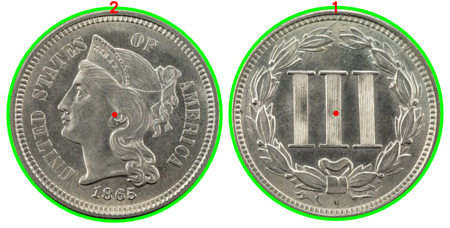
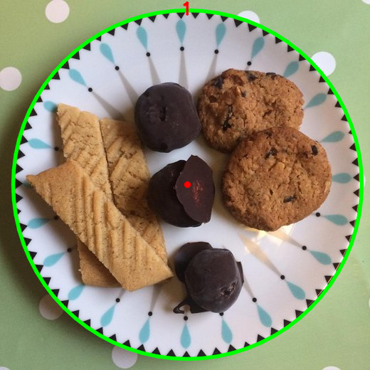

# hough-circle-gui

基于 OpenCV 的霍夫圆检测图形工具：导入实拍图片，调整检测参数，实时预览标注结果，并导出标注图。

> 当前状态（2026-11-17）：图片模式已完成并验收；视频导入检测尚未实现，需求与实施步骤见 [`openspec/changes/add-video-detection/`](openspec/changes/add-video-detection/)。交付分支为 `feat/video-detection`（规划提交 `1956a1f`）；接手人先读该目录的 `tasks.md`，从第 1 组开始。

## 功能

- 导入 JPG、JPEG、PNG、BMP 图片。
- 调整 `dp`、`minDist`、`param1`、`param2`、`minRadius`、`maxRadius`。
- 在画布上预览检测到的圆、圆心与编号。
- 导出带标注的 PNG 或 JPG。
- 内置「硬币」与「饼干盘」两组示例参数。

## 环境

已验证环境：

| 组件 | 版本 |
|---|---|
| OS | Ubuntu 24.04.5 LTS（WSL2） |
| Python | 3.12.3 |
| OpenCV | 4.6.0 |
| Tkinter | 8.6 |
| Pillow | 10.2.0 |

## 安装

```bash
sudo apt install -y python3-tk
python3 -m pip install -r requirements.txt
```

系统已提供 OpenCV、Tkinter、Pillow 时可跳过安装。

## 启动

从项目根目录运行：

```bash
cd ~/projects/hough-circle-gui
python3 main.py
```

界面操作：

- `Open Image` 选择本地图片。
- `Coins Sample` / `Plate Sample` 载入验收图片并自动应用预设。
- `Preset` 切换 `Auto`、`Coins`、`Cookie Plate` 或 `Custom`；`Custom` 由滑块自动切到。
- `Reset Params` 恢复 `Auto` 预设。
- 六个滑块调整检测参数；停止拖动约 150 ms 后自动刷新。
- `Detect` 立即重新检测。
- `Export Annotated` 导出当前标注图。

界面标签使用英文；本机未安装中文字体，避免 Tk 显示方框。

## 样例

两张验收图已随仓库提供，不需要联网或额外下载：

- `examples/coins.jpg`（760×385）：两枚硬币。
- `examples/cookie-plate.jpg`（520×520）：一个饼干盘。

GUI 的 `Coins Sample` / `Plate Sample` 按钮直接载入这两张图；也可以从 `examples/` 手动打开。来源与许可见 [examples/SOURCES.md](examples/SOURCES.md)。

视频样例尚未入库。实现视频功能时优先由上述两张图生成 2–5 秒片段，生成命令、大小和校验值记录在 `openspec/changes/add-video-detection/tasks.md` 的 1.1。

## 测试

```bash
python3 -m unittest discover -s tests -v
```

当前结果：7 个测试全部通过（2026-11-17 复核）。

## 验收

实际运行日期：2026-11-13。两张图均通过 GUI 载入、检测并导出标注图。

| 图片 | 预设 | dp | minDist | param1 | param2 | 半径范围 | 实际结果 |
|---|---|---|---|---|---|---|---|
| `examples/coins.jpg` | Coins | 1.2 | 250 | 100 | 30 | 120–200 | 2 个圆，两枚硬币外缘 |
| `examples/cookie-plate.jpg` | Cookie Plate | 1.2 | 250 | 100 | 30 | 200–270 | 1 个圆，盘沿 |

### 硬币图验收

使用 `Coins` 预设：`dp=1.2`、`minDist=250`、`param1=100`、`param2=30`、`minRadius=120`、`maxRadius=200`。实际检测到 2 个圆，圆心约 `(193, 193, r180)` 与 `(567, 191, r179)`。



### 饼干盘图验收

使用 `Cookie Plate` 预设：`dp=1.2`、`minDist=250`、`param1=100`、`param2=30`、`minRadius=200`、`maxRadius=270`。实际检测到 1 个圆，圆心约 `(263, 259, r245)`。



> 标注图中的绿圆为检测结果，红点为圆心。验收图已纳入 Git；`exports/` 仅用于本地临时导出，不入库。

其他已验证行为：

- GUI 可正常启动并进入事件循环。
- 拖动参数滑块会刷新结果；硬币图设置 `minDist=800` 时从 2 圆变为 1 圆。
- 导入无法解码的图片会提示错误并保留当前图片。
- 导出到不可写路径会提示错误，不崩溃。
- `openspec validate add-hough-circle-gui --strict` 通过。

## 当前限制与交接

- 图片模式已实现并验收；视频模式只有 OpenSpec 规划，尚无视频相关代码。
- 上述验收只在 Ubuntu 24.04.5 LTS（WSL2 + X11）完成；Windows、macOS、高 DPI、4K 大图和更多实拍场景未验证。
- 检测在 UI 线程执行，大图可能短暂卡顿；导出只覆盖当前图片，没有批量或视频导出。
- 完整未验证事项和后续待办见两个 change 的 `tasks.md` 末尾。
- 接手顺序：运行测试和两张示例图验收 → 阅读 `add-hough-circle-gui/tasks.md` 的完成进度 → 按 `add-video-detection/tasks.md` 从 1.1 开始 → 完成后更新验收记录和本 README。

## OpenSpec 记录

- [`openspec/changes/add-hough-circle-gui/`](openspec/changes/add-hough-circle-gui/)：图片工具，已实现并验收（13/13，2026-11-13 完成，2026-11-17 复核）。包含 `proposal.md`、`specs/hough-circle-gui/spec.md`、`design.md`、`tasks.md`。该 change 暂未归档，保留完整验收记录；评审通过后再同步到 `openspec/specs/`。
- [`openspec/changes/add-video-detection/`](openspec/changes/add-video-detection/)：视频导入检测，规划完成、代码未开始（2/23 任务：规格校验与规划文档推送已完成）。`tasks.md` 第 1 组是样例与解码器实测，接手从这里继续。

## 目录

```text
hough-circle-gui/
├─ main.py                    # 图形界面入口
├─ hough_circle_gui/
│  ├─ app.py                  # Tkinter 界面、预览、导出
│  ├─ detector.py             # 霍夫圆检测与标注
│  └─ presets.py              # 硬币/饼干盘/通用参数
├─ tests/test_detector.py     # 检测逻辑测试
├─ examples/                  # 验收原图与来源说明
├─ docs/acceptance/           # 两张标注结果图
├─ openspec/                  # OpenSpec 变更记录
├─ requirements.txt
├─ AGENTS.md
└─ README.md
```

## 图片授权

见 [examples/SOURCES.md](examples/SOURCES.md)。
